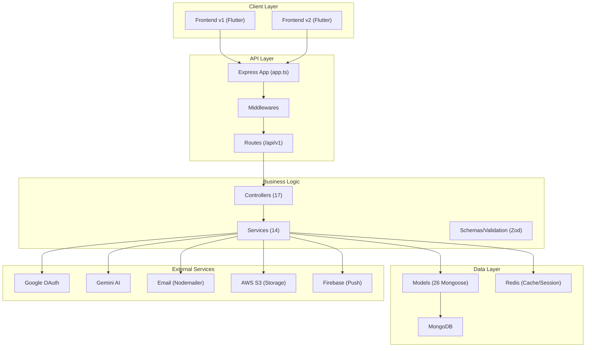
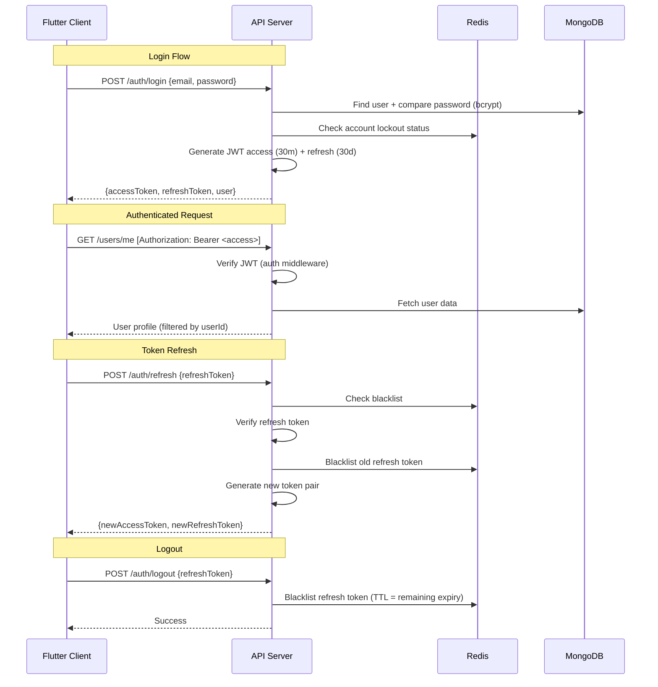

# HealthX Fullstack — Comprehensive Codebase Audit Report

> **Generated**: June 12, 2026  
> **Scope**: Backend (Node/Express/TypeScript), Frontend v1 (Flutter), Frontend v2 (Flutter — Redesign)

---

## Table of Contents

1. [Backend Architecture & Analysis](#1-backend-architecture--analysis)
2. [Frontend: v1 → v2 Feature Migration Gap Analysis](#2-frontend-v1--v2-feature-migration-gap-analysis)
3. [Code Quality Assessment](#3-code-quality-assessment)
4. [Hardcoded/Static Data Inventory (Frontend v2)](#4-hardcodedstatic-data-inventory-frontend-v2)
5. [Security Audit](#5-security-audit)
6. [Remediation Plan — Fixing All Issues](#6-remediation-plan--fixing-all-issues)

---

## 1. Backend Architecture & Analysis

### 1.1 Architecture Overview



### 1.2 Module Breakdown

| Layer | Count | Files |
|-------|-------|-------|
| Controllers | 17 | auth, user, tracker, medical, meal, order, doctor, appointment, notification, onboarding, address, content, prakriti, subscription, security, healthRecord, debug |
| Services | 14 | auth, cache, content, doctor, email, gemini, meal, oauth, onboarding, orderProgression, password-reset, security, session, storage |
| Models | 26 | User, Doctor, Patient, Order, Appointment, Address, plus 20 tracking/logging models |
| Middlewares | 7 | auth, audit, csrf, error, rateLimit, upload, validate |
| Schemas (Zod) | 12 | Validation for all major endpoints |
| Routes | 17 | Mounted under `/api/v1` |

### 1.3 Backend Quality Assessment

#### ✅ Strengths
- **Clean layered architecture**: Controller → Service → Model separation is well maintained
- **Consistent response format**: All responses follow `{ statusCode, status, message, data }` pattern
- **Error handling**: Centralized `AppError` + `catchAsync` wrapper pattern used everywhere
- **Zod validation**: Input validation via schemas on critical routes
- **Security middleware stack**: Helmet, CORS, mongo-sanitize, rate limiting, CSRF, audit logging
- **Graceful shutdown**: Proper signal handling with timeout in [server.ts](file:///p:/HealthX/HealthXFullstack/src/server.ts)
- **Health check endpoint**: Reports DB, Redis, and uptime status
- **Redis fallback**: Application works even if Redis is unavailable (in-memory fallback)
- **Token rotation**: Refresh tokens are blacklisted after use (single-use)
- **GDPR compliance**: Account deletion cascade in [user.controller.ts](file:///p:/HealthX/HealthXFullstack/src/controllers/user.controller.ts#L290-L321)

#### ⚠️ Issues Found

| # | Issue | Severity | Location |
|---|-------|----------|----------|
| B1 | `any` type used for query building in tracker/medical controllers | Medium | [tracker.controller.ts:L46](file:///p:/HealthX/HealthXFullstack/src/controllers/tracker.controller.ts#L46) |
| B2 | No pagination on list endpoints (water, sleep, glucose, vitals, measurements) | High | Multiple controllers |
| B3 | CSRF middleware exists but is **not applied** to any routes in `app.ts` or route files | High | [app.ts](file:///p:/HealthX/HealthXFullstack/src/app.ts), [csrf.middleware.ts](file:///p:/HealthX/HealthXFullstack/src/middlewares/csrf.middleware.ts) |
| B4 | Order progression runs as an unmanaged `setInterval` in server.ts — no error boundaries or health monitoring | Medium | [server.ts:L34-L37](file:///p:/HealthX/HealthXFullstack/src/server.ts#L34-L37) |
| B5 | `expiresAt` in `generateTokens()` hardcoded to 30 min instead of reading `config.jwt.accessExpiry` | Low | [auth.service.ts:L282](file:///p:/HealthX/HealthXFullstack/src/services/auth.service.ts#L282) |
| B6 | No API for Prakriti assessment **retrieval** — only submit exists | Medium | [prakriti.controller.ts](file:///p:/HealthX/HealthXFullstack/src/controllers/prakriti.controller.ts) |
| B7 | `content.service.ts` returns seeded/static data from DB — if DB is empty, returns nothing | Low | Content endpoints |
| B8 | No WebSocket/real-time support for chat — `ChatEndpoints` defined in frontend but no backend route | High | Missing backend |
| B9 | No `Prescription` model or route — endpoint defined in frontend with no backend support | High | Missing backend |
| B10 | Debug routes exposed without environment guard | Low | [debug.routes.ts](file:///p:/HealthX/HealthXFullstack/src/routes/debug.routes.ts) |

### 1.4 Missing Backend API Endpoints

These endpoints are referenced in frontend_v2's [api_constants.dart](file:///p:/HealthX/HealthXFullstack/frontend_v2/lib/core/network/api_constants.dart) but have **no backend implementation**:

| Frontend Endpoint Class | Endpoint | Backend Status |
|------------------------|----------|----------------|
| `ChatEndpoints` | `GET /chats/:id/messages` | ❌ **Missing** — No chat model, controller, or route |
| `ChatEndpoints` | `POST /chats/:id/messages` | ❌ **Missing** |
| `PrescriptionEndpoints` | `GET /prescriptions/:id` | ❌ **Missing** — No prescription model |
| `SubscriptionEndpoints.me` | `GET /subscriptions/me` | ✅ Exists |
| `SubscriptionEndpoints.subscribe` | `POST /subscriptions/subscribe` | ✅ Exists |

---

## 2. Frontend: v1 → v2 Feature Migration Gap Analysis

### 2.1 Architecture Comparison

| Aspect | Frontend v1 (Old) | Frontend v2 (New) |
|--------|-------------------|-------------------|
| Architecture | Flat screens folder | Feature-based (Clean Architecture) |
| State Management | Riverpod (basic) | Riverpod (structured providers/services) |
| Navigation | Named routes | GoRouter with shell routes |
| API Client | Custom HTTP service | Dio with interceptors + token refresh |
| Models | Mixed DTOs + models | Centralized core/models |
| Total Screens | **56 files** | **36 files** |

### 2.2 Feature Coverage Mapping

The v2 app is organized into **4 main navigation tabs** (Home, Tracker, Consults, Shop) plus supporting features. Below is the screen-by-screen migration status:

---

#### 🏠 **HOME Feature**

| v1 Screen | v2 Status | Notes |
|-----------|-----------|-------|
| [home_screen.dart](file:///p:/HealthX/HealthXFullstack/frontend/lib/screens/home_screen.dart) (79KB) | ✅ [home_screen.dart](file:///p:/HealthX/HealthXFullstack/frontend_v2/lib/features/home/presentation/home_screen.dart) (34KB) | Fully redesigned, dynamic data from API |

---

#### 📊 **TRACKER Feature**

| v1 Screen | v2 Status | Notes |
|-----------|-----------|-------|
| [tracker_screen.dart](file:///p:/HealthX/HealthXFullstack/frontend/lib/screens/tracker_screen.dart) | ✅ [tracker_screen.dart](file:///p:/HealthX/HealthXFullstack/frontend_v2/lib/features/tracker/presentation/tracker_screen.dart) | Hub screen |
| [water_tracker_screen.dart](file:///p:/HealthX/HealthXFullstack/frontend/lib/screens/water_tracker_screen.dart) | ✅ [water_tracker_screen.dart](file:///p:/HealthX/HealthXFullstack/frontend_v2/lib/features/tracker/presentation/water_tracker_screen.dart) | Backend connected |
| [sleep_tracker_screen.dart](file:///p:/HealthX/HealthXFullstack/frontend/lib/screens/sleep_tracker_screen.dart) | ✅ [sleep_tracker_screen.dart](file:///p:/HealthX/HealthXFullstack/frontend_v2/lib/features/tracker/presentation/sleep_tracker_screen.dart) | Backend connected |
| [steps_tracker_screen.dart](file:///p:/HealthX/HealthXFullstack/frontend/lib/screens/steps_tracker_screen.dart) | ✅ [steps_tracker_screen.dart](file:///p:/HealthX/HealthXFullstack/frontend_v2/lib/features/tracker/presentation/steps_tracker_screen.dart) | Native step sensor + API sync |
| [blood_glucose_screen.dart](file:///p:/HealthX/HealthXFullstack/frontend/lib/screens/blood_glucose_screen.dart) | ✅ [blood_glucose_screen.dart](file:///p:/HealthX/HealthXFullstack/frontend_v2/lib/features/tracker/presentation/blood_glucose_screen.dart) | Backend connected |
| [sleep_insights_screen.dart](file:///p:/HealthX/HealthXFullstack/frontend/lib/screens/sleep_insights_screen.dart) | ❌ **Missing** | Sleep analytics/insights page not migrated |
| [log_screen.dart](file:///p:/HealthX/HealthXFullstack/frontend/lib/screens/log_screen.dart) | ⚠️ Partial | Meal logging exists as [log_meal_sheet.dart](file:///p:/HealthX/HealthXFullstack/frontend_v2/lib/features/tracker/presentation/log_meal_sheet.dart) |
| [log_manually_screen.dart](file:///p:/HealthX/HealthXFullstack/frontend/lib/screens/log_manually_screen.dart) | ❌ **Missing** | Manual detailed meal log not migrated |
| [log_from_text_screen.dart](file:///p:/HealthX/HealthXFullstack/frontend/lib/screens/log_from_text_screen.dart) | ❌ **Missing** | AI text-based meal log not migrated |
| [nutrition_screen.dart](file:///p:/HealthX/HealthXFullstack/frontend/lib/screens/nutrition_screen.dart) | ❌ **Missing** | Nutrition breakdown not migrated |
| [counting_calories_screen.dart](file:///p:/HealthX/HealthXFullstack/frontend/lib/screens/counting_calories_screen.dart) | ❌ **Missing** | Calorie counter not migrated |
| [set_goal_screen.dart](file:///p:/HealthX/HealthXFullstack/frontend/lib/screens/set_goal_screen.dart) | ❌ **Missing** | Goal setting UI not migrated |
| [set_reminders_screen.dart](file:///p:/HealthX/HealthXFullstack/frontend/lib/screens/set_reminders_screen.dart) | ❌ **Missing** | Reminder configuration not migrated |

---

#### 🏥 **HEALTH Feature** (v2-exclusive feature group)

| v1 Screen | v2 Status | Notes |
|-----------|-----------|-------|
| [my_vitals_screen.dart](file:///p:/HealthX/HealthXFullstack/frontend/lib/screens/my_vitals_screen.dart) | ✅ [my_vitals_screen.dart](file:///p:/HealthX/HealthXFullstack/frontend_v2/lib/features/health/presentation/my_vitals_screen.dart) | Backend connected |
| [measurements_screen.dart](file:///p:/HealthX/HealthXFullstack/frontend/lib/screens/measurements_screen.dart) | ✅ [measurements_screen.dart](file:///p:/HealthX/HealthXFullstack/frontend_v2/lib/features/health/presentation/measurements_screen.dart) | Backend connected |
| [insulin_dosage_screen.dart](file:///p:/HealthX/HealthXFullstack/frontend/lib/screens/insulin_dosage_screen.dart) | ✅ [insulin_dosage_screen.dart](file:///p:/HealthX/HealthXFullstack/frontend_v2/lib/features/health/presentation/insulin_dosage_screen.dart) | Backend connected |
| [bmi_calculator_screen.dart](file:///p:/HealthX/HealthXFullstack/frontend/lib/screens/bmi_calculator_screen.dart) | ✅ [bmi_calculator_screen.dart](file:///p:/HealthX/HealthXFullstack/frontend_v2/lib/features/health/presentation/bmi_calculator_screen.dart) | Backend connected |
| [fat_calculator_screen.dart](file:///p:/HealthX/HealthXFullstack/frontend/lib/screens/fat_calculator_screen.dart) | ❌ **Missing** | Body fat calculator not migrated |
| [health_records.dart](file:///p:/HealthX/HealthXFullstack/frontend/lib/screens/health_records.dart) | ❌ **Missing** | Health records viewer/uploader not migrated |
| [dia_care_screen.dart](file:///p:/HealthX/HealthXFullstack/frontend/lib/screens/dia_care_screen.dart) | ❌ **Missing** | Diabetes care dashboard not migrated |
| [diabetic_care_screen.dart](file:///p:/HealthX/HealthXFullstack/frontend/lib/screens/diabetic_care_screen.dart) | ❌ **Missing** | Detailed diabetic care features not migrated |

---

#### 🩺 **CONSULTS Feature**

| v1 Screen | v2 Status | Notes |
|-----------|-----------|-------|
| [find_doctor_screen.dart](file:///p:/HealthX/HealthXFullstack/frontend/lib/screens/find_doctor_screen.dart) | ✅ [find_doctor_screen.dart](file:///p:/HealthX/HealthXFullstack/frontend_v2/lib/features/consults/presentation/find_doctor_screen.dart) + [consults_screen.dart](file:///p:/HealthX/HealthXFullstack/frontend_v2/lib/features/consults/presentation/consults_screen.dart) | Redesigned with combined search |
| — | ✅ [doctor_list_screen.dart](file:///p:/HealthX/HealthXFullstack/frontend_v2/lib/features/consults/presentation/doctor_list_screen.dart) | New filtered doctor listing |
| — | ✅ [doctor_profile_screen.dart](file:///p:/HealthX/HealthXFullstack/frontend_v2/lib/features/consults/presentation/doctor_profile_screen.dart) | New detailed doctor profile |
| — | ✅ [book_appointment_screen.dart](file:///p:/HealthX/HealthXFullstack/frontend_v2/lib/features/consults/presentation/book_appointment_screen.dart) | New booking flow |
| — | ✅ [appointment_detail_screen.dart](file:///p:/HealthX/HealthXFullstack/frontend_v2/lib/features/consults/presentation/appointment_detail_screen.dart) | New appointment details |
| — | ⚠️ [chat_screen.dart](file:///p:/HealthX/HealthXFullstack/frontend_v2/lib/features/consults/presentation/chat_screen.dart) | **UI only — no backend API** |
| — | ⚠️ [prescription_screen.dart](file:///p:/HealthX/HealthXFullstack/frontend_v2/lib/features/consults/presentation/prescription_screen.dart) | **UI only — no backend API** |

---

#### 🛒 **SHOP Feature**

| v1 Screen | v2 Status | Notes |
|-----------|-----------|-------|
| [category_detail_screen.dart](file:///p:/HealthX/HealthXFullstack/frontend/lib/screens/category_detail_screen.dart) | ✅ Integrated into [shop_screen.dart](file:///p:/HealthX/HealthXFullstack/frontend_v2/lib/features/shop/presentation/shop_screen.dart) | Category filtering |
| [product_detail_screen.dart](file:///p:/HealthX/HealthXFullstack/frontend/lib/screens/product_detail_screen.dart) | ✅ [product_detail_screen.dart](file:///p:/HealthX/HealthXFullstack/frontend_v2/lib/features/shop/presentation/product_detail_screen.dart) | Redesigned |
| [cart_screen.dart](file:///p:/HealthX/HealthXFullstack/frontend/lib/screens/cart_screen.dart) | ✅ [cart_screen.dart](file:///p:/HealthX/HealthXFullstack/frontend_v2/lib/features/shop/presentation/cart_screen.dart) | Redesigned |
| [checkout_screen.dart](file:///p:/HealthX/HealthXFullstack/frontend/lib/screens/checkout_screen.dart) | ✅ [checkout_screen.dart](file:///p:/HealthX/HealthXFullstack/frontend_v2/lib/features/shop/presentation/checkout_screen.dart) | Redesigned |
| [my_orders_screen.dart](file:///p:/HealthX/HealthXFullstack/frontend/lib/screens/my_orders_screen.dart) | ✅ [my_orders_screen.dart](file:///p:/HealthX/HealthXFullstack/frontend_v2/lib/features/shop/presentation/my_orders_screen.dart) | Redesigned |
| [order_tracking_screen.dart](file:///p:/HealthX/HealthXFullstack/frontend/lib/screens/order_tracking_screen.dart) | ✅ [order_tracking_screen.dart](file:///p:/HealthX/HealthXFullstack/frontend_v2/lib/features/shop/presentation/order_tracking_screen.dart) | Redesigned |
| [saved_addresses_screen.dart](file:///p:/HealthX/HealthXFullstack/frontend/lib/screens/saved_addresses_screen.dart) | ✅ [address_management_screen.dart](file:///p:/HealthX/HealthXFullstack/frontend_v2/lib/features/shop/presentation/address_management_screen.dart) | Combined with map picker |
| [add_delivery_address_screen.dart](file:///p:/HealthX/HealthXFullstack/frontend/lib/screens/add_delivery_address_screen.dart) | ✅ Integrated | Part of address management |
| [set_delivery_location_screen.dart](file:///p:/HealthX/HealthXFullstack/frontend/lib/screens/set_delivery_location_screen.dart) | ✅ [map_picker_screen.dart](file:///p:/HealthX/HealthXFullstack/frontend_v2/lib/features/shop/presentation/map_picker_screen.dart) | OpenStreetMap based |
| [favorites_screen.dart](file:///p:/HealthX/HealthXFullstack/frontend/lib/screens/favorites_screen.dart) | ❌ **Missing** | Favorites view not migrated |
| [food_detail_screen.dart](file:///p:/HealthX/HealthXFullstack/frontend/lib/screens/food_detail_screen.dart) | ❌ **Missing** | Detailed food info not migrated |
| [ready_to_eat_screen.dart](file:///p:/HealthX/HealthXFullstack/frontend/lib/screens/ready_to_eat_screen.dart) | ❌ **Missing** | Ready-to-eat catalogue not migrated |
| [healthy_bowl_screen.dart](file:///p:/HealthX/HealthXFullstack/frontend/lib/screens/healthy_bowl_screen.dart) | ❌ **Missing** | Health bowl builder not migrated |
| [zym_bowl_screen.dart](file:///p:/HealthX/HealthXFullstack/frontend/lib/screens/zym_bowl_screen.dart) | ❌ **Missing** | Zym bowl builder not migrated |
| [corporate_tie_up_bowl_screen.dart](file:///p:/HealthX/HealthXFullstack/frontend/lib/screens/corporate_tie_up_bowl_screen.dart) | ❌ **Missing** | Corporate offerings not migrated |
| [meal_plan_screen.dart](file:///p:/HealthX/HealthXFullstack/frontend/lib/screens/meal_plan_screen.dart) | ❌ **Missing** | Meal plans not migrated |
| [menu_screen.dart](file:///p:/HealthX/HealthXFullstack/frontend/lib/screens/menu_screen.dart) | ❌ **Missing** | Menu listing not migrated |

---

#### 👤 **PROFILE / AUTH Feature**

| v1 Screen | v2 Status | Notes |
|-----------|-----------|-------|
| [login_screen.dart](file:///p:/HealthX/HealthXFullstack/frontend/lib/screens/login_screen.dart) | ✅ [login_screen.dart](file:///p:/HealthX/HealthXFullstack/frontend_v2/lib/features/auth/presentation/login_screen.dart) | Redesigned, backend connected |
| [signup_screen.dart](file:///p:/HealthX/HealthXFullstack/frontend/lib/screens/signup_screen.dart) | ✅ [signup_screen.dart](file:///p:/HealthX/HealthXFullstack/frontend_v2/lib/features/auth/presentation/signup_screen.dart) | Redesigned, backend connected |
| [splash_screen.dart](file:///p:/HealthX/HealthXFullstack/frontend/lib/screens/splash_screen.dart) | ✅ [splash_screen.dart](file:///p:/HealthX/HealthXFullstack/frontend_v2/lib/features/auth/presentation/splash_screen.dart) | Redesigned |
| [profile_completion_screen.dart](file:///p:/HealthX/HealthXFullstack/frontend/lib/screens/profile_completion_screen.dart) | ✅ [profile_completion_screen.dart](file:///p:/HealthX/HealthXFullstack/frontend_v2/lib/features/auth/presentation/profile_completion_screen.dart) | Backend connected |
| [profile_screen.dart](file:///p:/HealthX/HealthXFullstack/frontend/lib/screens/profile_screen.dart) | ⚠️ Partial — [profile_drawer.dart](file:///p:/HealthX/HealthXFullstack/frontend_v2/lib/shared/widgets/profile_drawer.dart) | Sidebar drawer replaces dedicated profile screen |
| [settings_screen.dart](file:///p:/HealthX/HealthXFullstack/frontend/lib/screens/settings_screen.dart) | ✅ [settings_screen.dart](file:///p:/HealthX/HealthXFullstack/frontend_v2/lib/features/auth/presentation/settings_screen.dart) | Redesigned |
| [help_support_screen.dart](file:///p:/HealthX/HealthXFullstack/frontend/lib/screens/help_support_screen.dart) | ✅ [help_support_screen.dart](file:///p:/HealthX/HealthXFullstack/frontend_v2/lib/features/profile/presentation/help_support_screen.dart) | Redesigned |
| [notifications_screen.dart](file:///p:/HealthX/HealthXFullstack/frontend/lib/screens/notifications_screen.dart) | ✅ Migrated | Notifications feature exists |
| — | ✅ [forgot_password_screen.dart](file:///p:/HealthX/HealthXFullstack/frontend_v2/lib/features/auth/presentation/forgot_password_screen.dart) | **New** — backend connected |
| — | ✅ [reset_password_screen.dart](file:///p:/HealthX/HealthXFullstack/frontend_v2/lib/features/auth/presentation/reset_password_screen.dart) | **New** — backend connected |

---

#### 🏆 **REWARDS Feature**

| v1 Screen | v2 Status | Notes |
|-----------|-----------|-------|
| [health_rewards_screen.dart](file:///p:/HealthX/HealthXFullstack/frontend/lib/screens/health_rewards_screen.dart) | ✅ [rewards_screen.dart](file:///p:/HealthX/HealthXFullstack/frontend_v2/lib/features/rewards/presentation/rewards_screen.dart) | Redesigned, backend connected |
| [wellness_goals_screen.dart](file:///p:/HealthX/HealthXFullstack/frontend/lib/screens/wellness_goals_screen.dart) | ❌ **Missing** | Wellness goals editor not migrated |

---

#### ❌ **Completely Missing from v2**

| v1 Screen | Category | Description |
|-----------|----------|-------------|
| [ai_identify_screen.dart](file:///p:/HealthX/HealthXFullstack/frontend/lib/screens/ai_identify_screen.dart) | Tracker | AI food identification via camera |
| [correct_ingredients_screen.dart](file:///p:/HealthX/HealthXFullstack/frontend/lib/screens/correct_ingredients_screen.dart) | Tracker | Ingredient correction for AI |
| [meal_type_sheet.dart](file:///p:/HealthX/HealthXFullstack/frontend/lib/screens/meal_type_sheet.dart) | Tracker | Meal type selector sheet |
| [age_prakriti_screen.dart](file:///p:/HealthX/HealthXFullstack/frontend/lib/screens/age_prakriti_screen.dart) | Health | Prakriti/Dosha assessment quiz |
| [image_zoom_screen.dart](file:///p:/HealthX/HealthXFullstack/frontend/lib/screens/image_zoom_screen.dart) | Utility | Image pinch-zoom viewer |

### 2.3 Migration Summary

| Category | Total in v1 | Migrated to v2 | Missing | Coverage |
|----------|-------------|-----------------|---------|----------|
| Home | 1 | 1 | 0 | **100%** |
| Tracker | 12 | 6 | 6 | **50%** |
| Health | 8 | 4 | 4 | **50%** |
| Consults | 1 | 8 (expanded) | 0* | **100%** (but 2 screens UI-only) |
| Shop | 16 | 8 | 8 | **50%** |
| Profile/Auth | 7 | 9 (expanded) | 0 | **100%** |
| Rewards | 2 | 1 | 1 | **50%** |
| Utility | 1 | 0 | 1 | **0%** |

> **Overall v1→v2 migration: ~62% complete** with 20 screens/features still needing migration.

---

## 3. Code Quality Assessment

### 3.1 Backend Code Quality

#### Structure ✅ Good
- Consistent controller → service → model layering
- Every controller function uses `catchAsync` wrapper
- Centralized error handling with `AppError`
- Zod schemas for input validation on key routes

#### Naming Conventions ⚠️ Mixed
| Pattern | Files | Convention |
|---------|-------|------------|
| Models | `User.ts`, `GlucoseLog.ts` | PascalCase ✅ |
| Controllers | `auth.controller.ts`, `healthRecord.controller.ts` | camelCase with dot ⚠️ inconsistent (`healthRecord` vs `health-records` in routes) |
| Routes | `auth.routes.ts` | Consistent ✅ |
| Services | `auth.service.ts`, `password-reset.service.ts` | Mixed camelCase/kebab-case ⚠️ |

#### Dead Code / Unwanted Code

| Issue | Location | Details |
|-------|----------|---------|
| Empty comment block `// Initialize Passport` | [app.ts:L78-79](file:///p:/HealthX/HealthXFullstack/src/app.ts#L78-L79) | Passport was removed but comment remains |
| Debug routes exposed in production | [routes/index.ts:L39](file:///p:/HealthX/HealthXFullstack/src/routes/index.ts#L39) | `router.use('/debug', debugRoutes)` — no env check |
| Empty lines in package.json dependencies | [package.json:L43,56,72,80](file:///p:/HealthX/HealthXFullstack/package.json#L43) | Blank lines between deps |
| `upload-keystore.jks` committed to repo | Frontend v1 root | **Security risk** — signing keys in version control |
| `.env` file committed with real secrets | [.env](file:///p:/HealthX/HealthXFullstack/.env) | JWT secrets, Google OAuth credentials exposed |

#### Industry Practices Assessment

| Practice | Status |
|----------|--------|
| TypeScript strict mode | ❌ Not enforced — `any` types used |
| API versioning | ✅ `/api/v1` prefix |
| Request logging | ✅ Morgan + custom Winston logger |
| Test coverage | ⚠️ Test infrastructure exists but coverage unknown |
| CI/CD pipeline | ⚠️ `.github` folder exists but not verified |
| Swagger documentation | ✅ Available at `/api-docs` in non-production |
| Database migrations | ❌ No migration system — relies on Mongoose schema changes |
| Input sanitization | ✅ `express-mongo-sanitize` applied globally |
| Rate limiting | ✅ Configured but selectively applied |

### 3.2 Frontend v2 Code Quality

#### Structure ✅ Excellent
```
lib/
├── core/          # Cross-cutting concerns
│   ├── models/    # Shared data models
│   ├── navigation/# GoRouter configuration
│   ├── network/   # Dio client, API constants
│   ├── services/  # Platform services (step counter, notifications)
│   └── theme/     # Design tokens
├── features/      # Feature modules
│   ├── auth/
│   │   ├── presentation/  # Screens
│   │   ├── providers/     # State management
│   │   └── services/      # API calls
│   ├── home/
│   ├── tracker/
│   ├── health/
│   ├── consults/
│   ├── shop/
│   ├── rewards/
│   ├── notifications/
│   └── profile/
└── shared/        # Reusable components
    ├── widgets/   # Custom card, button, badge, shimmer
    └── utils/     # Health score calculator
```

#### Naming Conventions ✅ Consistent
- File names: `snake_case.dart`
- Classes: `PascalCase`
- Variables/methods: `camelCase`
- Constants: `camelCase` (Dart convention)
- Providers: `nameProvider` pattern

#### Dead Code / Concerns

| Issue | Location | Details |
|-------|----------|---------|
| `_calculateScore` wrapper function delegates to same-named utility | [home_screen.dart:L28-30](file:///p:/HealthX/HealthXFullstack/frontend_v2/lib/features/home/presentation/home_screen.dart#L28-L30) | Dead wrapper — `calculateScore` already imported |
| `_timeAgo` wrapper delegates to utility | [home_screen.dart:L32-34](file:///p:/HealthX/HealthXFullstack/frontend_v2/lib/features/home/presentation/home_screen.dart#L32-L34) | Dead wrapper |
| `analyze_output.txt` (59KB) committed | [frontend_v2 root](file:///p:/HealthX/HealthXFullstack/frontend_v2/analyze_output.txt) | Should be in .gitignore |
| `frontend_v2.iml` IDE file committed | Frontend v2 root | Should be in .gitignore |
| `NotificationsScreen` in navigation but no dedicated screen content verified | Navigation | Needs verification |

---

## 4. Hardcoded/Static Data Inventory (Frontend v2)

> [!CAUTION]
> All hardcoded data below should be replaced with dynamic API-driven content for production readiness.

### 4.1 Subscription Plans — **100% Hardcoded**

**File**: [shop_screen.dart:L533-L576](file:///p:/HealthX/HealthXFullstack/frontend_v2/lib/features/shop/presentation/shop_screen.dart#L533-L576)

```dart
// HARDCODED plan IDs, names, prices, and features
_buildPlanCard(planId: 'basic', planName: 'Basic Plan', price: 499, features: [...])
_buildPlanCard(planId: 'pro', planName: 'Pro Plan', price: 999, features: [...])
_buildPlanCard(planId: 'elite', planName: 'Elite Plan', price: 1999, features: [...])
```

**Required**: Backend endpoint `GET /subscriptions/plans` to return available plans dynamically.

---

### 4.2 Rewards Goals — **Hardcoded Thresholds**

**File**: [rewards_screen.dart:L25-L43](file:///p:/HealthX/HealthXFullstack/frontend_v2/lib/features/rewards/presentation/rewards_screen.dart#L25-L43)

```dart
const stepsGoal = 10000;      // Should read from user settings
const sleepGoalMins = 420;     // 7 hours — should be configurable
const waterGoal = 2500;        // Should read from user settings
```

These should use `user.dailyStepGoal`, `user.dailyWaterGoalMl`, and a new sleep goal setting.

---

### 4.3 Home Screen — Hardcoded Labels

**File**: [home_screen.dart:L80](file:///p:/HealthX/HealthXFullstack/frontend_v2/lib/features/home/presentation/home_screen.dart#L80)

```dart
'Your vital signs are looking stable today.' // Static — should be dynamic health summary
```

**File**: [home_screen.dart:L253-L254](file:///p:/HealthX/HealthXFullstack/frontend_v2/lib/features/home/presentation/home_screen.dart#L253-L254)

```dart
'Supplements'           // Static shop title
'Starting from ₹499'    // Hardcoded price — should come from API
```

---

### 4.4 Doctor Specialties — **Hardcoded List**

**File**: [consults_screen.dart:L674-L680](file:///p:/HealthX/HealthXFullstack/frontend_v2/lib/features/consults/presentation/consults_screen.dart#L674-L680)

```dart
_buildSpecialtyTile(context, 'Diabetologist', ...)
_buildSpecialtyTile(context, 'Cardiologist', ...)
_buildSpecialtyTile(context, 'General Physician', ...)
_buildSpecialtyTile(context, 'Dermatologist', ...)
_buildSpecialtyTile(context, 'Neurologist', ...)
_buildSpecialtyTile(context, 'Pediatrician', ...)
```

**Required**: Backend endpoint `GET /doctors/specialties` to return available specialties dynamically.

---

### 4.5 Help & Support — **Hardcoded Contact Info & FAQs**

**File**: [help_support_screen.dart:L86-L146](file:///p:/HealthX/HealthXFullstack/frontend_v2/lib/features/profile/presentation/help_support_screen.dart#L86-L146)

- Email: `support@healthxworld.com` — hardcoded
- WhatsApp: `919876543210` — hardcoded
- FAQs: 4 hardcoded Q&A pairs

**Required**: Backend endpoint `GET /content/support-info` for dynamic support config and FAQs.

---

### 4.6 Rewards Point Values — **Hardcoded**

**File**: [rewards_screen.dart:L150-L189](file:///p:/HealthX/HealthXFullstack/frontend_v2/lib/features/rewards/presentation/rewards_screen.dart#L150-L189)

```dart
pointValue: 50,  // Steps reward
pointValue: 30,  // Sleep reward
pointValue: 20,  // Water reward
```

**Required**: Backend endpoint `GET /rewards/tasks` to return daily task definitions with point values.

---

### 4.7 Summary Table of All Hardcoded Data

| Item | File | Hardcoded Value | Required Backend API |
|------|------|-----------------|---------------------|
| Subscription plans (3) | shop_screen.dart | IDs, names, prices, features | `GET /subscriptions/plans` |
| Steps goal in rewards | rewards_screen.dart | `10000` | User settings API |
| Sleep goal in rewards | rewards_screen.dart | `420 mins (7h)` | User settings API |
| Water goal in rewards | rewards_screen.dart | `2500 mL` | User settings API |
| Reward point values | rewards_screen.dart | `50, 30, 20` | `GET /rewards/config` |
| Shop banner price | home_screen.dart | `₹499` | Content/banners API |
| Health status text | home_screen.dart | Static message | Health score API |
| Doctor specialties | consults_screen.dart | 6 specialties | `GET /doctors/specialties` |
| Support email | help_support_screen.dart | `support@healthxworld.com` | `GET /content/support` |
| Support WhatsApp | help_support_screen.dart | `919876543210` | `GET /content/support` |
| FAQ items | help_support_screen.dart | 4 items | `GET /content/faqs` |

---

## 5. Security Audit

### 5.1 Authentication Pipeline



#### ✅ Authentication Strengths
- JWT-based with separate access/refresh token secrets
- Token rotation on refresh (old refresh token blacklisted)
- Account lockout after 5 failed attempts (15 min)
- Google OAuth ID token verification on server-side
- Password hashing via bcrypt with salt rounds
- Automatic token refresh in Dio interceptor (client-side)
- Concurrent refresh request deduplication (completer pattern)

#### 🔴 Critical Security Issues

| # | Issue | Severity | Details |
|---|-------|----------|---------|
| S1 | **`.env` committed to Git with real JWT secrets** | 🔴 **Critical** | [.env:L16-L17](file:///p:/HealthX/HealthXFullstack/.env#L16-L17) — JWT secret and refresh secret are committed in plaintext. Also Google OAuth client ID/secret exposed. |
| S2 | **`upload-keystore.jks` committed to Git** | 🔴 **Critical** | Android signing keystore in version control — allows anyone to sign APKs |
| S3 | **CSRF middleware defined but NEVER applied** | 🔴 **High** | [csrf.middleware.ts](file:///p:/HealthX/HealthXFullstack/src/middlewares/csrf.middleware.ts) exists but is not imported or used in any route or app.ts |
| S4 | **No access token blacklisting on logout** | Medium | Only refresh tokens are blacklisted; access tokens remain valid until expiry (30 min window) |
| S5 | **CORS allows all origins in development** | Medium | [app.ts:L46](file:///p:/HealthX/HealthXFullstack/src/app.ts#L46) — `config.env === 'development'` bypasses all origin checks |

### 5.2 Data Isolation

#### ✅ Proper Isolation
- **Every data query is scoped by `userId`**: All tracker, medical, order, address, appointment, and notification queries include `userId: req.user.userId`
- **Delete operations double-check ownership**: `findOneAndDelete({ _id: req.params.id, userId: req.user.userId })`
- **Profile endpoints only return authenticated user's data**
- **Upload paths include userId**: Avatar storage path is `uploads/avatars/{userId}/`
- **Account deletion cascades**: GDPR-compliant full data purge across all collections

#### ⚠️ Data Isolation Concerns

| # | Issue | Severity | Details |
|---|-------|----------|---------|
| D1 | Content endpoints (categories, banners, menu items) have **no auth requirement** | Low | Public data by design, but could leak product catalog strategy |
| D2 | Doctor listing endpoint returns **all doctors** without pagination | Medium | Potential data scraping risk |
| D3 | No rate limiting on tracker endpoints | Medium | User could flood the DB with water/sleep/step logs |
| D4 | Health records endpoint lacks **document-level access control** for shared documents | Low | Documents in uploads/documents are behind auth but any authenticated user could potentially access others' files if they guess the path |

### 5.3 Password Security

| Check | Status |
|-------|--------|
| Minimum length 8 chars | ✅ |
| Requires uppercase | ✅ (config) |
| Requires numbers | ✅ (config) |
| Requires special chars | ✅ (config) |
| bcrypt hashing | ✅ (10 rounds) |
| Password not returned in API responses | ✅ (`select: false`) |
| Password reset flow | ✅ Token-based with expiry |

### 5.4 Security Headers

| Header | Status |
|--------|--------|
| Helmet CSP | ✅ |
| HSTS | ✅ (1 year, includeSubDomains, preload) |
| X-Content-Type-Options | ✅ nosniff |
| X-Frame-Options | ✅ SAMEORIGIN |
| X-XSS-Protection | ✅ (note: deprecated in modern browsers) |
| Referrer-Policy | ✅ strict-origin-when-cross-origin |
| Permissions-Policy | ✅ |
| Mongo Sanitize | ✅ |

---

## 6. Remediation Plan — Fixing All Issues

> [!IMPORTANT]
> The plan below is ordered by priority and designed to be implemented **incrementally without breaking existing functionality**. Each phase is independently deployable.

---

### Phase 1: 🔴 Critical Security Fixes (Immediate)

#### 1A. Remove Secrets from Version Control

```diff
# .gitignore — add these immediately
+ .env
+ .env.*
+ !.env.example
+ !.env.production.example
+ upload-keystore.jks
+ *.jks
+ analyze_output.txt
+ *.iml
```

**Steps:**
1. Add entries to `.gitignore`
2. Run `git rm --cached .env upload-keystore.jks frontend_v2/analyze_output.txt`
3. **Rotate all compromised secrets immediately**: JWT secrets, Google OAuth client secret, MongoDB password, Redis password
4. Generate new JWT secrets via `openssl rand -hex 64`
5. Regenerate Google OAuth client secret in Google Cloud Console

#### 1B. Apply CSRF Protection

The CSRF middleware is fully implemented but never mounted. For a Flutter mobile client, CSRF is less critical (CSRF primarily targets browser-based apps), but the middleware should either be:
- **Applied** to web-facing routes, OR
- **Explicitly documented as not needed for mobile API**

**Recommended**: Add a comment in `app.ts` explaining the design decision, and apply CSRF only if a web frontend is added later.

#### 1C. Fix Debug Routes

```typescript
// routes/index.ts — wrap debug routes with environment check
if (config.env !== 'production') {
  router.use('/debug', debugRoutes);
}
```

---

### Phase 2: Missing Backend APIs (1-2 weeks)

#### 2A. Chat API

Create:
- `src/models/ChatMessage.ts` — message model with `appointmentId`, `senderId`, `content`, `timestamp`
- `src/controllers/chat.controller.ts` — `getMessages`, `sendMessage`
- `src/routes/chat.routes.ts` — mounted under `/api/v1/chats`
- **Data isolation**: Messages filtered by `appointmentId` which is itself filtered by `userId`

#### 2B. Prescription API

Create:
- `src/models/Prescription.ts` — linked to `appointmentId`, `doctorId`
- `src/controllers/prescription.controller.ts` — `getPrescription`
- `src/routes/prescription.routes.ts` — mounted under `/api/v1/prescriptions`

#### 2C. Dynamic Content APIs

Create new endpoints:
- `GET /content/subscription-plans` — replaces hardcoded plan data
- `GET /content/reward-tasks` — replaces hardcoded reward point values
- `GET /content/support-info` — support email, WhatsApp, FAQs
- `GET /doctors/specialties` — dynamic specialty list

#### 2D. Prakriti Assessment Retrieval

Add to existing prakriti controller:
- `GET /prakriti/latest` — returns user's most recent assessment result

---

### Phase 3: Replace Hardcoded Data in Frontend v2 (1 week)

For each hardcoded item, the pattern is:

1. **Create a service method** that calls the new backend endpoint
2. **Create/update the provider** to fetch and cache the data
3. **Update the screen** to read from the provider instead of constants

Priority order:
1. Subscription plans → most user-impacting
2. Rewards goals and point values → uses existing user settings
3. Doctor specialties → simple API addition
4. Support info & FAQs → low risk
5. Home screen dynamic text → nice-to-have

---

### Phase 4: Feature Migration (2-4 weeks)

Migrate the 20 missing v1 screens, organized by the v2 feature architecture:

#### 4A. Tracker Feature Additions
| Screen | Priority | Backend Exists? |
|--------|----------|-----------------|
| Sleep Insights | High | ✅ (needs aggregation endpoint) |
| Manual Meal Log | High | ✅ meal API exists |
| Nutrition Breakdown | Medium | ✅ meal data has nutrition |
| Set Goals | High | ✅ user settings API exists |
| Set Reminders | Medium | Partial — needs notification schedule API |
| Calorie Counter | Medium | ✅ meal data |
| Text-based Meal Log | Low | ✅ (may need Gemini integration) |

#### 4B. Health Feature Additions
| Screen | Priority | Backend Exists? |
|--------|----------|-----------------|
| Health Records | High | ✅ healthRecord API exists |
| Prakriti Assessment | High | ✅ prakriti API exists |
| Fat Calculator | Medium | ✅ measurement data exists |
| Diabetes Care | Medium | ✅ glucose/insulin data exists |

#### 4C. Shop Feature Additions
| Screen | Priority | Backend Exists? |
|--------|----------|-----------------|
| Favorites | High | ✅ toggle favorite API exists |
| Meal Plans | Medium | ✅ content API has meal plans |
| Menu/Food Detail | Medium | ✅ content API has menu items |
| Ready-to-eat / Bowl builders | Low | Partially via content API |

#### 4D. Other
| Screen | Priority | Backend Exists? |
|--------|----------|-----------------|
| Wellness Goals Editor | Medium | ✅ wellness goals API exists |
| AI Food Identification | Low | Needs Gemini integration |

---

### Phase 5: Code Quality Improvements (1 week)

#### 5A. Backend
1. **Add pagination** to all list endpoints: `?page=1&limit=20`
2. **Remove `any` types** in query builders — use proper TypeScript interfaces
3. **Fix `expiresAt` calculation** in `generateTokens()` to use `config.jwt.accessExpiry`
4. **Standardize naming**: Pick either `camelCase` or `kebab-case` for services and stick with it
5. **Remove dead code**: Passport comment, empty lines in package.json
6. **Add error boundaries** around order progression interval

#### 5B. Frontend v2
1. **Remove dead wrapper functions** (`_calculateScore`, `_timeAgo` in home_screen.dart)
2. **Add `.gitignore` entries** for `analyze_output.txt`, `*.iml`
3. **Add error state handling** in screens that currently show only loading/success states
4. **Add pagination support** in list views (orders, doctors, logs)

---

### Phase 6: Production Readiness Checklist

| Item | Status | Action Needed |
|------|--------|---------------|
| Secrets management | ❌ | Remove from Git, use env vars only |
| HTTPS enforcement | ✅ Config ready | Verify Nginx/reverse proxy setup |
| Database indexes | ✅ | Already defined on User model |
| Error tracking | ⚠️ Sentry DSN configured but integration not verified | Verify Sentry SDK integration |
| Logging | ✅ Winston + Morgan | Verify log rotation in production |
| Health check | ✅ | Available at `/health` |
| Graceful shutdown | ✅ | SIGTERM/SIGINT handlers in place |
| Docker support | ✅ | Dockerfile + docker-compose ready |
| API documentation | ✅ | Swagger at `/api-docs` |
| Test infrastructure | ✅ | Jest + supertest configured |
| Rate limiting | ⚠️ Configured | Verify applied to all sensitive routes |
| Input validation | ⚠️ Zod schemas exist | Verify all routes use validation middleware |
| CORS production config | ⚠️ | Must set explicit `CORS_ORIGINS` in production |
| Flutter release signing | ❌ | Move keystore out of repo, use CI/CD secrets |

---

> [!TIP]
> **Recommended Implementation Order**: Phase 1 → Phase 2A/2B → Phase 3 → Phase 4A/4B → Phase 5 → Phase 6
> 
> This ensures security is fixed first, then backend APIs are created before frontend integration, and code quality is cleaned up before final production checks.
